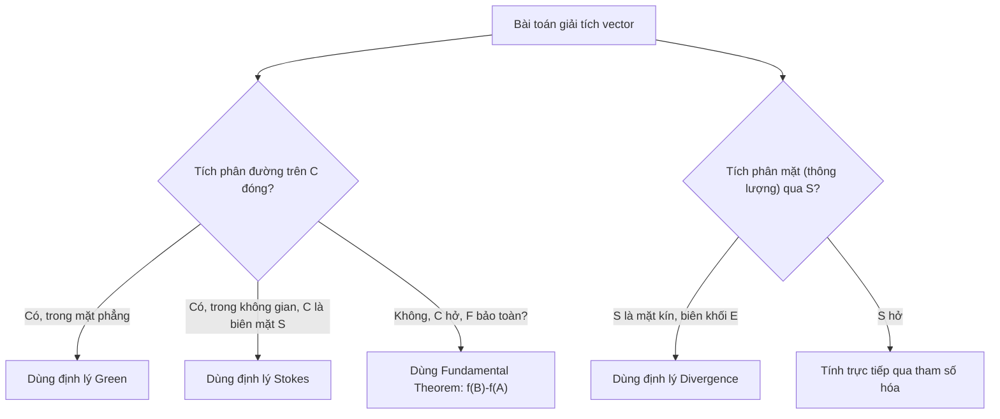

# GIẢI TÍCH VECTOR (VECTOR CALCULUS)

> Tài liệu tổng hợp đầy đủ theo chương trình chuẩn (tương ứng Chương 16 – Stewart, *Calculus*), bao gồm lý thuyết, công thức, định lý và ví dụ minh họa cho từng phần.

---

## Mục lục

1. [Trường Vector (Vector Fields)](#1-trường-vector-vector-fields)
2. [Tích phân Đường (Line Integrals)](#2-tích-phân-đường-line-integrals)
3. [Định lý Cơ bản cho Tích phân Đường](#3-định-lý-cơ-bản-cho-tích-phân-đường)
4. [Định lý Green](#4-định-lý-green)
5. [Curl (Rota) và Divergence (Dive)](#5-curl-rota-và-divergence-dive)
6. [Mặt Tham số hóa và Diện tích](#6-mặt-tham-số-hóa-và-diện-tích)
7. [Tích phân Mặt (Surface Integrals)](#7-tích-phân-mặt-surface-integrals)
8. [Định lý Stokes](#8-định-lý-stokes)
9. [Định lý Divergence (Gauss)](#9-định-lý-divergence-gauss)
10. [Tổng kết & Bảng công thức](#10-tổng-kết--bảng-công-thức)

---

## 1. Trường Vector (Vector Fields)

### 1.1 Định nghĩa

Một **trường vector** trên $\mathbb{R}^2$ (hoặc $\mathbb{R}^3$) là một hàm $\mathbf{F}$ gán cho mỗi điểm $(x,y)$ (hoặc $(x,y,z)$) một **vector** $\mathbf{F}(x,y)$:

$$\mathbf{F}(x,y) = P(x,y)\,\mathbf{i} + Q(x,y)\,\mathbf{j}$$

$$\mathbf{F}(x,y,z) = P(x,y,z)\,\mathbf{i} + Q(x,y,z)\,\mathbf{j} + R(x,y,z)\,\mathbf{k}$$

Trong đó $P, Q, R$ là các **hàm vô hướng** (scalar field), gọi là các **hàm thành phần** của $\mathbf{F}$.

**Ý nghĩa vật lý:** trường vận tốc của chất lỏng, trường lực hấp dẫn, trường lực tĩnh điện, trường gradient...

### 1.2 Trường Gradient

Nếu $f$ là hàm nhiều biến khả vi thì **gradient** của nó:

$$\nabla f(x,y,z) = f_x\,\mathbf{i} + f_y\,\mathbf{j} + f_z\,\mathbf{k}$$

là một trường vector, gọi là **trường vector gradient**.

**Định nghĩa trường bảo toàn (conservative field):** $\mathbf{F}$ được gọi là trường vector bảo toàn nếu nó là gradient của một hàm vô hướng nào đó, tức tồn tại $f$ sao cho $\mathbf{F} = \nabla f$. Hàm $f$ được gọi là **hàm thế vị** (potential function) của $\mathbf{F}$.

### 1.3 Ví dụ minh họa

**Ví dụ:** Trường vector $\mathbf{F}(x,y) = -y\,\mathbf{i} + x\,\mathbf{j}$ — mỗi vector vuông góc với bán kính vector tại điểm đó, độ lớn bằng khoảng cách tới gốc tọa độ → mô tả chuyển động quay quanh gốc tọa độ.

---

## 2. Tích phân Đường (Line Integrals)

### 2.1 Tích phân đường của hàm vô hướng

Cho đường cong trơn $C$ tham số hóa bởi $\mathbf{r}(t) = (x(t), y(t))$, $a \le t \le b$. Tích phân đường của $f$ dọc $C$:

$$\int_C f(x,y)\,ds = \int_a^b f(x(t), y(t))\sqrt{\left(\frac{dx}{dt}\right)^2 + \left(\frac{dy}{dt}\right)^2}\,dt$$

Với $ds = |\mathbf{r}'(t)|\,dt$ là vi phân độ dài cung.

**Tích phân theo $x$ và theo $y$:**

$$\int_C f(x,y)\,dx = \int_a^b f(x(t),y(t))\,x'(t)\,dt, \qquad \int_C f(x,y)\,dy = \int_a^b f(x(t),y(t))\,y'(t)\,dt$$

**Tính chất:** Nếu $C$ gồm nhiều đoạn trơn $C_1, C_2, \dots, C_n$ nối tiếp nhau thì:

$$\int_C f\,ds = \int_{C_1} f\,ds + \int_{C_2} f\,ds + \cdots + \int_{C_n} f\,ds$$

### 2.2 Tích phân đường trong không gian

Tương tự với $\mathbf{r}(t) = (x(t), y(t), z(t))$:

$$\int_C f(x,y,z)\,ds = \int_a^b f(\mathbf{r}(t))\,|\mathbf{r}'(t)|\,dt$$

### 2.3 Tích phân đường của trường vector

Cho $\mathbf{F}$ là trường vector liên tục xác định trên $C$. Tích phân đường của $\mathbf{F}$ dọc $C$ (thường biểu diễn **công** sinh ra khi di chuyển một hạt dọc $C$ trong trường lực $\mathbf{F}$):

$$\int_C \mathbf{F} \cdot d\mathbf{r} = \int_a^b \mathbf{F}(\mathbf{r}(t)) \cdot \mathbf{r}'(t)\,dt = \int_C \mathbf{F} \cdot \mathbf{T}\,ds$$

Trong đó $\mathbf{T}$ là vector tiếp tuyến đơn vị. Nếu $\mathbf{F} = P\,\mathbf{i} + Q\,\mathbf{j} + R\,\mathbf{k}$:

$$\int_C \mathbf{F}\cdot d\mathbf{r} = \int_C P\,dx + Q\,dy + R\,dz$$

**Lưu ý quan trọng:** Tích phân đường của trường vector phụ thuộc vào **hướng** của $C$: $\int_{-C} \mathbf{F}\cdot d\mathbf{r} = -\int_C \mathbf{F}\cdot d\mathbf{r}$, trong khi tích phân đường của hàm vô hướng thì **không** phụ thuộc hướng.

### 2.4 Ví dụ

Tính $\int_C \mathbf{F}\cdot d\mathbf{r}$ với $\mathbf{F}(x,y) = xy\,\mathbf{i} + y^2\,\mathbf{j}$, $C: \mathbf{r}(t) = (t^2, t^3)$, $0\le t\le 1$.

- $\mathbf{r}'(t) = (2t, 3t^2)$
- $\mathbf{F}(\mathbf{r}(t)) = (t^2\cdot t^3, t^6) = (t^5, t^6)$
- $\mathbf{F}\cdot\mathbf{r}' = 2t^6 + 3t^8$
- $\int_0^1 (2t^6 + 3t^8)\,dt = \dfrac{2}{7} + \dfrac{1}{3} = \dfrac{13}{21}$

---

## 3. Định lý Cơ bản cho Tích phân Đường

### 3.1 Định lý Cơ bản (Fundamental Theorem for Line Integrals)

Cho $C$ là đường cong trơn từng khúc nằm trong miền $D$, với $\mathbf{r}(t)$, $a \le t \le b$, điểm đầu $A = \mathbf{r}(a)$ và điểm cuối $B = \mathbf{r}(b)$. Nếu $f$ khả vi và $\nabla f$ liên tục trên $C$ thì:

$$\int_C \nabla f \cdot d\mathbf{r} = f(B) - f(A)$$

**Ý nghĩa:** Tích phân đường của trường gradient chỉ phụ thuộc điểm đầu và điểm cuối, **không** phụ thuộc đường đi.

### 3.2 Tính độc lập đường đi (Independence of Path)

$\int_C \mathbf{F}\cdot d\mathbf{r}$ được gọi là **độc lập đường đi** trong miền $D$ nếu $\int_{C_1}\mathbf{F}\cdot d\mathbf{r} = \int_{C_2}\mathbf{F}\cdot d\mathbf{r}$ với mọi đường $C_1, C_2$ có cùng điểm đầu, điểm cuối trong $D$.

**Định lý:** $\int_C \mathbf{F}\cdot d\mathbf{r}$ độc lập đường đi trong $D$ (mở, liên thông) $\iff$ $\int_C \mathbf{F}\cdot d\mathbf{r} = 0$ với mọi đường cong **đóng** $C$ trong $D$.

**Định lý:** Nếu $\mathbf{F}$ liên tục trên miền mở liên thông $D$ và $\int_C\mathbf{F}\cdot d\mathbf{r}$ độc lập đường đi trong $D$, thì $\mathbf{F}$ là trường vector bảo toàn, tức tồn tại $f$ với $\mathbf{F}=\nabla f$.

### 3.3 Điều kiện nhận biết trường bảo toàn

Nếu $\mathbf{F} = P\,\mathbf{i} + Q\,\mathbf{j}$ là trường bảo toàn, với $P, Q$ có đạo hàm riêng cấp 1 liên tục trên miền mở $D$ thì trên $D$:

$$\frac{\partial P}{\partial y} = \frac{\partial Q}{\partial x}$$

**Định lý đảo (quan trọng):** Nếu $P, Q$ có đạo hàm riêng liên tục trên miền **mở, đơn liên** (simply-connected) $D$, và $\dfrac{\partial P}{\partial y} = \dfrac{\partial Q}{\partial x}$ trên toàn $D$, thì $\mathbf{F}$ là trường bảo toàn.

> **Miền đơn liên**: miền liên thông mà mọi đường cong đóng đơn trong nó đều có thể co lại thành 1 điểm mà không ra khỏi miền (không có "lỗ thủng").

### 3.4 Cách tìm hàm thế vị $f$

Giải hệ $f_x = P$, $f_y = Q$ (và $f_z = R$ trong không gian) bằng cách lấy tích phân từng phần rồi so khớp đạo hàm riêng.

**Ví dụ:** $\mathbf{F}(x,y) = (3+2xy)\,\mathbf{i} + (x^2-3y^2)\,\mathbf{j}$.

Kiểm tra: $P_y = 2x = Q_x$ ✓ → $\mathbf{F}$ bảo toàn.

- $f_x = 3+2xy \Rightarrow f = 3x + x^2y + g(y)$
- $f_y = x^2 + g'(y) = x^2 - 3y^2 \Rightarrow g'(y) = -3y^2 \Rightarrow g(y) = -y^3 + K$

Vậy $f(x,y) = 3x + x^2y - y^3 + K$.

### 3.5 Định luật bảo toàn năng lượng

Trong trường lực bảo toàn $\mathbf{F} = -\nabla p$ ($p$: thế năng), tổng động năng + thế năng là hằng số dọc theo quỹ đạo chuyển động — đây là nguồn gốc tên gọi "trường bảo toàn".

---

## 4. Định lý Green

### 4.1 Phát biểu

Cho $C$ là đường cong **đóng, đơn, trơn từng khúc**, hướng dương (ngược chiều kim đồng hồ), biên của miền $D$. Nếu $P, Q$ có đạo hàm riêng liên tục trên một miền mở chứa $D$ thì:

$$\oint_C P\,dx + Q\,dy = \iint_D \left(\frac{\partial Q}{\partial x} - \frac{\partial P}{\partial y}\right)dA$$

### 4.2 Ứng dụng tính diện tích

Chọn $P, Q$ sao cho $Q_x - P_y = 1$, ví dụ $P=0, Q=x$ hoặc $P=-y, Q=0$ hoặc đối xứng $P=-y/2, Q=x/2$:

$$A = \oint_C x\,dy = -\oint_C y\,dx = \frac{1}{2}\oint_C x\,dy - y\,dx$$

### 4.3 Mở rộng cho miền không đơn liên

Với miền $D$ có biên gồm nhiều đường cong (ví dụ miền có lỗ thủng), định lý Green vẫn áp dụng được nếu biên ngoài lấy hướng dương, biên trong (các lỗ) lấy hướng âm (để miền $D$ luôn nằm "bên trái" khi đi dọc biên).

### 4.4 Ví dụ

Tính $\oint_C xy^2\,dx + x^2y\,dy$ với $C$ là biên hình vuông $[0,1]\times[0,1]$ hướng dương.

$Q_x - P_y = 2xy - 2xy = 0 \Rightarrow \oint_C \mathbf{F}\cdot d\mathbf{r} = 0$.

---

## 5. Curl (Rota) và Divergence (Dive)

### 5.1 Toán tử Nabla

$$\nabla = \frac{\partial}{\partial x}\mathbf{i} + \frac{\partial}{\partial y}\mathbf{j} + \frac{\partial}{\partial z}\mathbf{k}$$

### 5.2 Curl (Rota)

Với $\mathbf{F} = P\mathbf{i}+Q\mathbf{j}+R\mathbf{k}$:

$$\text{curl}\,\mathbf{F} = \nabla \times \mathbf{F} = \left(\frac{\partial R}{\partial y}-\frac{\partial Q}{\partial z}\right)\mathbf{i} + \left(\frac{\partial P}{\partial z}-\frac{\partial R}{\partial x}\right)\mathbf{j} + \left(\frac{\partial Q}{\partial x}-\frac{\partial P}{\partial y}\right)\mathbf{k}$$

Dễ nhớ dưới dạng định thức:

$$\text{curl}\,\mathbf{F} = \begin{vmatrix} \mathbf{i} & \mathbf{j} & \mathbf{k} \\ \partial/\partial x & \partial/\partial y & \partial/\partial z \\ P & Q & R \end{vmatrix}$$

**Ý nghĩa:** đo mức độ "xoáy" (quay) của trường tại một điểm.

**Định lý:** Nếu $f$ có đạo hàm riêng cấp 2 liên tục thì $\text{curl}(\nabla f) = \mathbf{0}$. Do đó: *mọi trường bảo toàn đều có curl bằng 0* (điều kiện cần).

**Định lý (đảo, trên miền đơn liên):** Nếu $\mathbf{F}$ xác định trên toàn $\mathbb{R}^3$, có đạo hàm riêng liên tục và $\text{curl}\,\mathbf{F} = \mathbf{0}$ thì $\mathbf{F}$ là trường bảo toàn.

### 5.3 Divergence (Dive)

$$\text{div}\,\mathbf{F} = \nabla\cdot\mathbf{F} = \frac{\partial P}{\partial x} + \frac{\partial Q}{\partial y} + \frac{\partial R}{\partial z}$$

Kết quả là **hàm vô hướng**. Ý nghĩa: đo "tốc độ giãn nở/nguồn phát" của trường tại một điểm (nguồn nếu div > 0, hút/rò nếu div < 0).

**Định lý:** $\text{div}(\text{curl}\,\mathbf{F}) = 0$ với mọi trường $\mathbf{F}$ có đạo hàm riêng cấp 2 liên tục.

### 5.4 Toán tử Laplace

$$\nabla^2 f = \text{div}(\nabla f) = \frac{\partial^2 f}{\partial x^2} + \frac{\partial^2 f}{\partial y^2} + \frac{\partial^2 f}{\partial z^2}$$

### 5.5 Dạng vector của định lý Green

$$\oint_C \mathbf{F}\cdot d\mathbf{r} = \iint_D (\text{curl}\,\mathbf{F})\cdot\mathbf{k}\,dA \qquad \oint_C \mathbf{F}\cdot\mathbf{n}\,ds = \iint_D \text{div}\,\mathbf{F}(x,y)\,dA$$

---

## 6. Mặt Tham số hóa và Diện tích

### 6.1 Mặt tham số hóa

Một mặt $S$ được cho bởi hàm vector 2 biến:

$$\mathbf{r}(u,v) = x(u,v)\,\mathbf{i} + y(u,v)\,\mathbf{j} + z(u,v)\,\mathbf{k}, \quad (u,v)\in D$$

**Ví dụ điển hình:**
- Mặt cầu bán kính $a$: $\mathbf{r}(\phi,\theta) = a\sin\phi\cos\theta\,\mathbf{i} + a\sin\phi\sin\theta\,\mathbf{j} + a\cos\phi\,\mathbf{k}$
- Mặt trụ: $\mathbf{r}(\theta,z) = a\cos\theta\,\mathbf{i} + a\sin\theta\,\mathbf{j} + z\,\mathbf{k}$
- Đồ thị hàm $z=f(x,y)$: $\mathbf{r}(x,y) = x\,\mathbf{i} + y\,\mathbf{j} + f(x,y)\,\mathbf{k}$

### 6.2 Mặt phẳng tiếp xúc & vector pháp tuyến

Tại điểm $(u_0, v_0)$, hai vector tiếp tuyến:

$$\mathbf{r}_u = \frac{\partial x}{\partial u}\mathbf{i}+\frac{\partial y}{\partial u}\mathbf{j}+\frac{\partial z}{\partial u}\mathbf{k}, \qquad \mathbf{r}_v = \frac{\partial x}{\partial v}\mathbf{i}+\frac{\partial y}{\partial v}\mathbf{j}+\frac{\partial z}{\partial v}\mathbf{k}$$

**Mặt trơn (smooth)** tại điểm nếu $\mathbf{r}_u \times \mathbf{r}_v \ne \mathbf{0}$ — vector pháp tuyến tại điểm đó là $\mathbf{r}_u\times\mathbf{r}_v$.

### 6.3 Diện tích mặt tham số hóa

$$A(S) = \iint_D |\mathbf{r}_u \times \mathbf{r}_v|\,dA$$

**Trường hợp đồ thị $z=f(x,y)$:**

$$A(S) = \iint_D \sqrt{1+\left(\frac{\partial z}{\partial x}\right)^2+\left(\frac{\partial z}{\partial y}\right)^2}\,dA$$

### 6.4 Ví dụ: Diện tích mặt cầu

$|\mathbf{r}_\phi \times \mathbf{r}_\theta| = a^2\sin\phi$, nên:

$$A = \int_0^{2\pi}\int_0^\pi a^2\sin\phi\,d\phi\,d\theta = 4\pi a^2$$

---

## 7. Tích phân Mặt (Surface Integrals)

### 7.1 Tích phân mặt của hàm vô hướng

$$\iint_S f(x,y,z)\,dS = \iint_D f(\mathbf{r}(u,v))\,|\mathbf{r}_u\times\mathbf{r}_v|\,dA$$

Trường hợp $z=g(x,y)$:

$$\iint_S f\,dS = \iint_D f(x,y,g(x,y))\sqrt{1+g_x^2+g_y^2}\,dA$$

### 7.2 Mặt định hướng (Oriented Surfaces)

Mặt $S$ gọi là **định hướng được (orientable)** nếu có thể chọn một trường vector pháp tuyến đơn vị $\mathbf{n}$ liên tục trên toàn $S$ (ví dụ: *dải Möbius* **không** định hướng được).

Với mặt kín, quy ước **hướng dương** là pháp tuyến hướng ra ngoài.

### 7.3 Tích phân mặt của trường vector (Thông lượng – Flux)

$$\iint_S \mathbf{F}\cdot d\mathbf{S} = \iint_S \mathbf{F}\cdot\mathbf{n}\,dS = \iint_D \mathbf{F}(\mathbf{r}(u,v))\cdot(\mathbf{r}_u\times\mathbf{r}_v)\,dA$$

Đại lượng này gọi là **thông lượng (flux)** của $\mathbf{F}$ qua $S$.

**Trường hợp $z=g(x,y)$, hướng lên trên:**

$$\iint_S \mathbf{F}\cdot d\mathbf{S} = \iint_D \left(-P\frac{\partial g}{\partial x} - Q\frac{\partial g}{\partial y} + R\right)dA$$

### 7.4 Ví dụ

Tính thông lượng của $\mathbf{F} = z\,\mathbf{i} + y\,\mathbf{j} + x\,\mathbf{k}$ qua mặt cầu đơn vị hướng ra ngoài.

Dùng tham số hóa cầu: kết quả tính được $\iint_S \mathbf{F}\cdot d\mathbf{S} = \dfrac{4\pi}{3}$ (có thể kiểm chứng nhanh hơn bằng định lý Divergence ở Mục 9).

---

## 8. Định lý Stokes

### 8.1 Phát biểu

Cho $S$ là mặt định hướng, trơn từng khúc, có biên là đường cong $C$ đóng, đơn, trơn từng khúc, với **hướng dương** (theo quy tắc bàn tay phải: nếu ngón cái chỉ theo pháp tuyến $\mathbf{n}$ thì các ngón còn lại chỉ chiều đi dọc $C$). Nếu $\mathbf{F}$ có các thành phần với đạo hàm riêng liên tục trên một miền mở chứa $S$:

$$\oint_C \mathbf{F}\cdot d\mathbf{r} = \iint_S \text{curl}\,\mathbf{F}\cdot d\mathbf{S}$$

**Ý nghĩa:** Định lý Green là trường hợp đặc biệt của định lý Stokes khi $S$ nằm phẳng trong mặt $xy$.

### 8.2 Ứng dụng

- Chuyển tích phân đường khó thành tích phân mặt dễ hơn (hoặc ngược lại).
- Nếu $C$ là biên của **nhiều** mặt $S_1, S_2$ khác nhau (cùng hướng phù hợp) thì $\iint_{S_1}\text{curl}\,\mathbf{F}\cdot d\mathbf{S} = \iint_{S_2}\text{curl}\,\mathbf{F}\cdot d\mathbf{S}$ — chọn mặt tính toán đơn giản nhất.

### 8.3 Ví dụ

Tính $\oint_C \mathbf{F}\cdot d\mathbf{r}$ với $\mathbf{F} = -y^2\mathbf{i} + x\mathbf{j} + z^2\mathbf{k}$, $C$ là giao của mặt trụ $x^2+y^2=1$ và mặt phẳng $y+z=2$, hướng ngược chiều kim đồng hồ nhìn từ trên xuống.

$\text{curl}\,\mathbf{F} = (0,0,1+2y)$. Chọn $S$ là phần mặt phẳng $y+z=2$ nằm trong trụ, pháp tuyến hướng lên: $\mathbf{r}_x\times\mathbf{r}_y = (0,1,1)$.

$$\oint_C \mathbf{F}\cdot d\mathbf{r} = \iint_{x^2+y^2\le 1} (1+2y)\,dA = \pi$$

(vì $\iint 2y\,dA = 0$ do đối xứng, $\iint 1\,dA = \pi$).

---

## 9. Định lý Divergence (Gauss)

### 9.1 Phát biểu

Cho $E$ là miền **rắn đơn giản** (solid region) trong $\mathbb{R}^3$, biên là mặt kín $S$ với hướng dương (pháp tuyến hướng ra ngoài). Nếu các thành phần của $\mathbf{F}$ có đạo hàm riêng liên tục trên miền mở chứa $E$:

$$\iint_S \mathbf{F}\cdot d\mathbf{S} = \iiint_E \text{div}\,\mathbf{F}\,dV$$

### 9.2 Ý nghĩa vật lý

Thông lượng ra khỏi mặt kín $S$ bằng tổng "lượng phát sinh" (nguồn) bên trong $E$ — nền tảng cho định luật Gauss trong điện từ học, phương trình liên tục trong cơ học chất lỏng.

### 9.3 Ví dụ

Tính thông lượng của $\mathbf{F} = xy\,\mathbf{i} + (y^2+e^{xz^2})\,\mathbf{j} + \sin(xy)\,\mathbf{k}$ qua biên của miền $E$ giới hạn bởi parabol $z=1-x^2$ (giữa) và các mặt phẳng tọa độ.

$\text{div}\,\mathbf{F} = y + 2y + 0 = 3y$. Nếu $E$ đối xứng qua mặt phẳng $y=0$... (tùy miền cụ thể, kỹ thuật là chuyển sang tính $\iiint_E 3y\,dV$ bằng tích phân bội — đơn giản hơn nhiều so với tính trực tiếp 3-4 mặt tích phân mặt).

**Ví dụ chuẩn:** Với $\mathbf{F}=z\mathbf{i}+y\mathbf{j}+x\mathbf{k}$ qua mặt cầu đơn vị: $\text{div}\,\mathbf{F}=1$, nên

$$\iint_S \mathbf{F}\cdot d\mathbf{S} = \iiint_E 1\,dV = \frac{4}{3}\pi(1)^3 = \frac{4\pi}{3}$$

(khớp với kết quả tính trực tiếp ở Mục 7.4).

---

## 10. Tổng kết & Bảng công thức

### 10.1 Bộ ba định lý lớn — "Họ hàng" của Định lý cơ bản của Giải tích

| Định lý | Miền | Biên | Công thức |
|---|---|---|---|
| **Fundamental Theorem (đường)** | Đường cong $C$ | 2 điểm đầu/cuối | $\int_C \nabla f\cdot d\mathbf{r} = f(B)-f(A)$ |
| **Green** | Miền phẳng $D$ | Đường cong đóng $C$ | $\oint_C P\,dx+Q\,dy = \iint_D (Q_x-P_y)\,dA$ |
| **Stokes** | Mặt cong $S$ | Đường cong đóng $C$ | $\oint_C \mathbf{F}\cdot d\mathbf{r} = \iint_S \text{curl}\,\mathbf{F}\cdot d\mathbf{S}$ |
| **Divergence (Gauss)** | Khối $E$ | Mặt kín $S$ | $\iint_S \mathbf{F}\cdot d\mathbf{S} = \iiint_E \text{div}\,\mathbf{F}\,dV$ |

Tất cả đều có chung một tinh thần: **tích phân của "đạo hàm" trên một miền = tích phân của hàm gốc trên biên của miền đó.**

### 10.2 Bảng công thức nhanh

| Đại lượng | Công thức |
|---|---|
| Trường gradient | $\nabla f = f_x\mathbf{i}+f_y\mathbf{j}+f_z\mathbf{k}$ |
| Tích phân đường (vô hướng) | $\int_C f\,ds = \int_a^b f(\mathbf{r}(t))\|\mathbf{r}'(t)\|dt$ |
| Tích phân đường (trường vector) | $\int_C \mathbf{F}\cdot d\mathbf{r} = \int_a^b \mathbf{F}(\mathbf{r}(t))\cdot\mathbf{r}'(t)\,dt$ |
| Điều kiện trường bảo toàn (2D) | $P_y = Q_x$ |
| Curl | $\nabla\times\mathbf{F}$ |
| Divergence | $\nabla\cdot\mathbf{F}$ |
| Diện tích mặt tham số | $\iint_D \|\mathbf{r}_u\times\mathbf{r}_v\|\,dA$ |
| Thông lượng | $\iint_S \mathbf{F}\cdot d\mathbf{S}$ |

### 10.3 Lưu đồ chọn công cụ giải bài tập

### 10.4 Lời khuyên khi học

1. Luôn kiểm tra **điều kiện định hướng** (hướng đường cong / pháp tuyến mặt) trước khi áp dụng định lý — sai hướng sẽ sai dấu.
2. Khi gặp tích phân mặt/đường **phức tạp**, luôn tự hỏi: "có thể dùng Green/Stokes/Divergence để đổi sang miền dễ tính hơn không?"
3. Ghi nhớ: **curl = 0** là điều kiện cần (và đủ trên miền đơn liên) để trường bảo toàn; **div(curl F) = 0** luôn đúng — dùng để kiểm tra tính toán.
4. Luyện tập tham số hóa mặt (cầu, trụ, nón, mặt phẳng, đồ thị hàm) thật thành thạo — đây là bước hay sai nhất.

---

*Tài liệu biên soạn dựa trên cấu trúc chương trình Giải tích Vector chuẩn (Chương "Vector Calculus"). Phù hợp để ôn tập, dạy học hoặc tra cứu nhanh công thức.*
